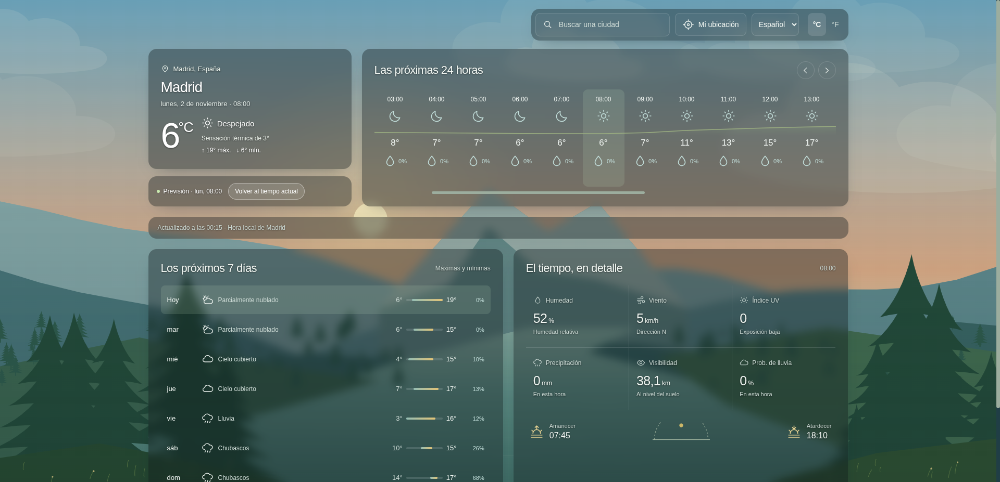
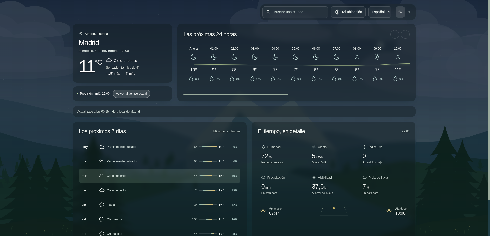
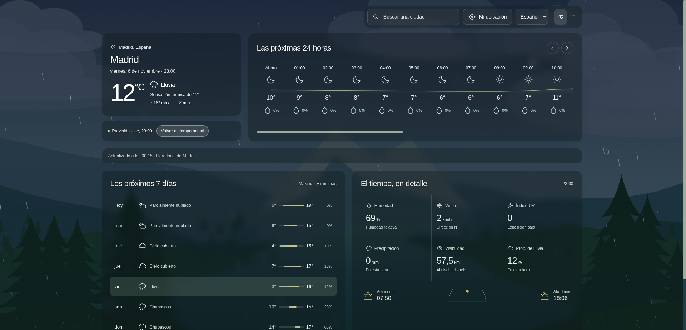
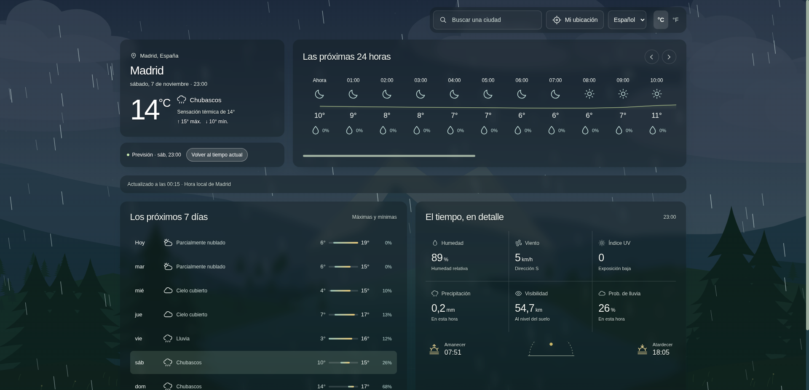
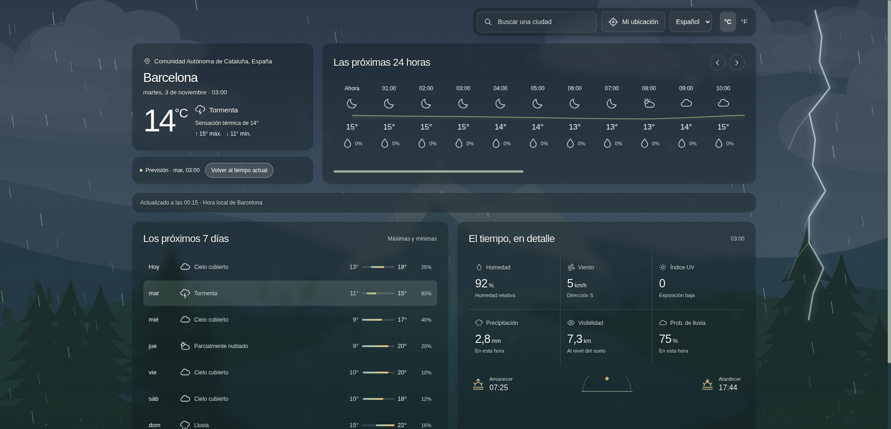
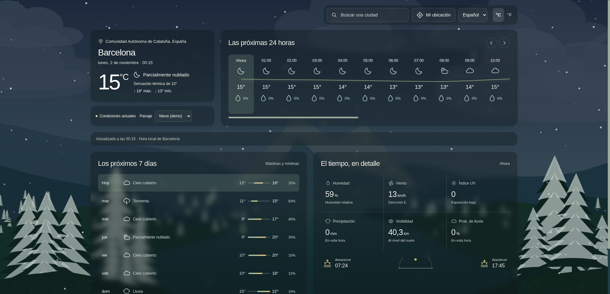
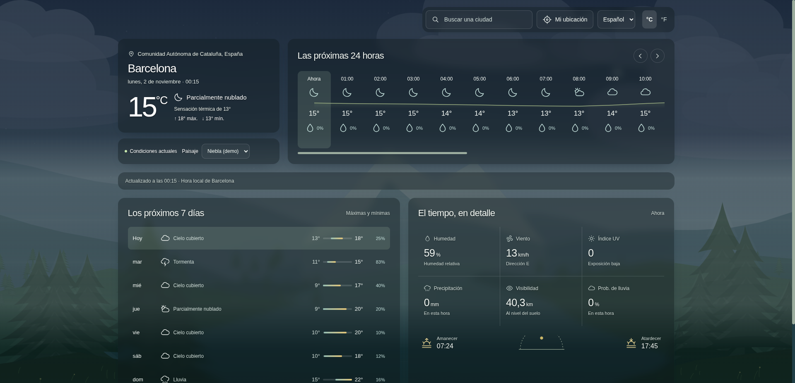
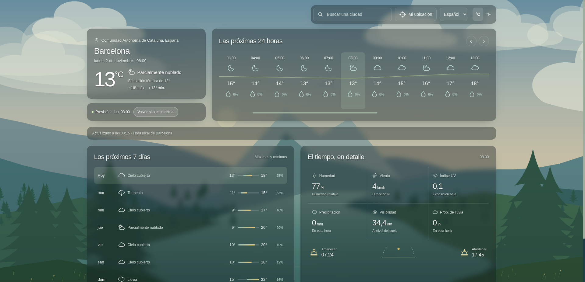
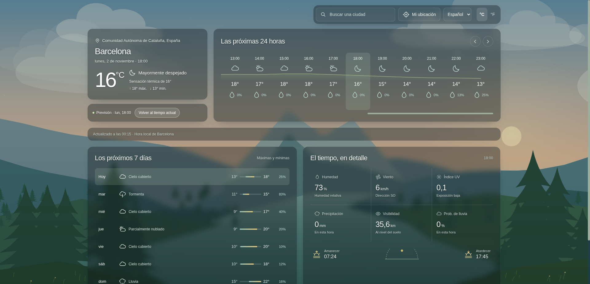
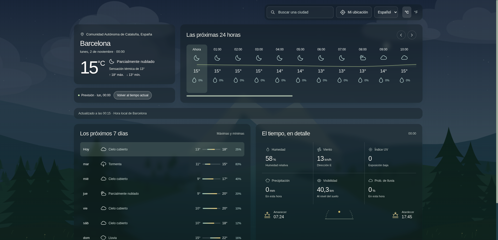

# Visualizador meteorológico moderno

Aplicación meteorológica con un paisaje animado que cambia según el tiempo y la hora local de la ubicación consultada. Además de mostrar temperaturas y previsiones, representa las condiciones sobre un valle con montañas, un lago, árboles, vegetación y un cielo en movimiento.

El escenario ocupa el fondo de la pantalla. La información aparece en paneles translúcidos con desenfoque, dejando ver el entorno mientras se consulta el tiempo.



## Un escenario que sigue al tiempo

El paisaje se construye con **Canvas 2D**, sin imágenes estáticas para representar las condiciones meteorológicas. La aplicación interpreta los códigos WMO y los datos de Open-Meteo para ajustar la iluminación, las nubes, las precipitaciones y el movimiento de la vegetación.

Los cambios se combinan entre sí: una tormenta puede ocurrir de noche, un amanecer puede estar cubierto de niebla y un atardecer puede tener lluvia. La hora se calcula en la zona horaria de la ciudad consultada, utilizando también sus horarios de amanecer y atardecer.

### Condiciones meteorológicas

| Condición | Cambios en el paisaje |
| --- | --- |
| Despejado | Luz solar, cielo más abierto, vegetación en movimiento y pájaros ocasionales durante el día. |
| Nublado | Mayor cobertura de nubes, luz más difusa y una atmósfera menos saturada. |
| Lluvia | Más nubes, gotas a distintas profundidades y ondas sobre el agua. La cantidad de precipitación influye en la intensidad visual. |
| Chubascos | Gotas más densas, rápidas y visibles, con una cobertura de nubes mayor que en la lluvia normal. |
| Tormenta | Cielo más oscuro, lluvia intensa y rayos ramificados con destellos breves e intervalos variables. |
| Nieve | Copos a distintas velocidades y una acumulación visual progresiva sobre el suelo y los árboles. |
| Niebla | Capas de bruma que reducen la visibilidad y ocultan parcialmente las montañas y la vegetación. |

### Ciclo de luz

- **Amanecer:** tonos cálidos y una transición gradual desde la oscuridad.
- **Día:** iluminación que se adapta a la nubosidad y a las condiciones previstas.
- **Atardecer:** luz dorada y anaranjada, con el sol acercándose al horizonte.
- **Noche:** cielo oscuro, luna y estrellas, cuya visibilidad depende de la nubosidad.

### Explorar el paisaje de otra hora

Seleccionar una hora de la previsión cambia tanto los datos como el escenario: se utilizan las condiciones previstas para ese momento, incluida su iluminación local.

Al seleccionar un día, la aplicación busca una hora de ese día que coincida con su condición meteorológica. Si hay precipitaciones, prioriza la mayor intensidad entre las horas coincidentes. Así, seleccionar un día lluvioso permite ver una hora con lluvia en lugar de mostrar siempre el mediodía.

El botón **«Volver al tiempo actual»** permite regresar a las condiciones actuales.

## Capturas de los escenarios

Las capturas de los distintos escenarios se organizan en `docs/capturas/`.

### Cielo nublado



### Lluvia



### Chubascos



### Tormenta



### Nieve



### Niebla



### Amanecer



### Atardecer



### Noche



## Qué se puede consultar

- Tiempo actual, temperatura, sensación térmica y máximas y mínimas.
- Previsión de las próximas **24 horas**, con evolución de temperaturas, condiciones y probabilidad de lluvia.
- Previsión de los próximos **7 días**, con rangos térmicos y probabilidad de precipitación.
- Humedad, viento y dirección, índice UV, precipitación y visibilidad.
- Horarios de amanecer y atardecer de la ubicación seleccionada.

La aplicación incluye búsqueda de ciudades con sugerencias, geolocalización, cambio entre Celsius y Fahrenheit, y selector de español e inglés. El idioma predeterminado es español; las preferencias se guardan en el navegador.

El diseño se adapta a escritorio, tablet y móvil. Los controles tienen etiquetas accesibles y se pueden utilizar con teclado.

## Datos meteorológicos

La aplicación utiliza [Open-Meteo](https://open-meteo.com/), sin necesidad de configurar una clave de API:

- **Forecast API:** condiciones actuales y previsiones horarias y diarias.
- **Geocoding API:** búsqueda de ciudades.
- **Códigos WMO:** interpretación de las condiciones meteorológicas para los textos, iconos y efectos del escenario.

Los datos se guardan temporalmente durante **10 minutos** para evitar peticiones innecesarias. La actualización automática comprueba si corresponde renovar la información mientras la pestaña está visible.

Si falla la conexión o la API, se muestra un mensaje con opción de reintentar. No se generan datos meteorológicos ficticios para sustituir la respuesta.

## Tecnologías y estructura

HTML5, CSS3 y JavaScript, sin frameworks, librerías de animación ni proceso de compilación.

```text
.
├── index.html             # Estructura de la interfaz y símbolos SVG
├── css/
│   └── styles.css         # Estilos, paneles, responsive y movimiento reducido
├── js/
│   ├── app.js             # API, estado, interacciones y paisaje en Canvas
│   └── i18n.js            # Traducciones y preferencia de idioma
├── docs/
│   └── capturas/          # Capturas de los escenarios meteorológicos
└── README.md
```

### Animación y rendimiento

Las animaciones continuas utilizan `requestAnimationFrame`. Las gotas se actualizan a unos **60 fps**, mientras el paisaje se reutiliza desde un búfer y se redibuja a unos **30 fps** para reducir el trabajo por fotograma.

La cantidad de partículas se adapta al ancho de pantalla y tiene un límite. Su desplazamiento se acumula en cada fotograma: cambiar la intensidad de la lluvia modifica la velocidad sin hacer retroceder las gotas.

El bucle de animación se detiene al ocultar la pestaña. Con `prefers-reduced-motion`, se muestra una escena estática que conserva las condiciones visuales, sin rayos ni destellos.

## Ejecutar en local

Desde la carpeta del proyecto, inicia un servidor estático. Por ejemplo, con Python 3:

```sh
python3 -m http.server 8080
```

Abre **http://localhost:8080** en el navegador. No hace falta instalar paquetes ni compilar archivos.

La aplicación muestra inicialmente el tiempo de una ubicación aproximada. Para obtener una previsión más precisa, se puede utilizar **«Mi ubicación»** o buscar otra ciudad.

Las consultas de datos necesitan conexión a internet. Para publicar la aplicación, sirve `index.html` junto a las carpetas `css/` y `js/` en un alojamiento estático.
